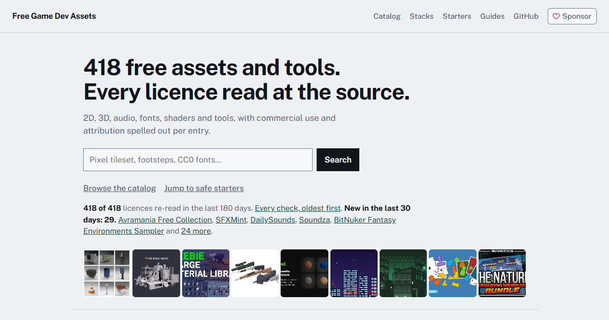
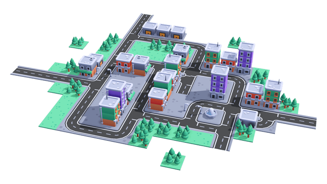
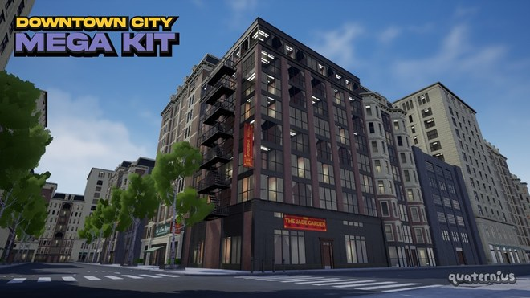
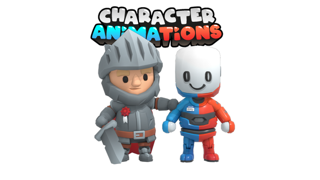
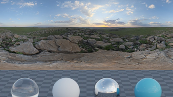

# Free Game Dev Assets

**Free assets and tools for commercial games, with every licence read at its source.**

[**Browse 418 sources**](https://tmhsdigital.github.io/Free-Game-Dev-Assets/)  ·  [Starter stacks](#starter-stacks)  ·  [Choose by job](#start-here)  ·  [Licences](#licences)  ·  [Contribute](#contributing)

 

Each entry records the licence as its source states it and the date someone read it there;
active entries quote the source's own words. The catalog indexes sources and never rehosts
them: check the source before you ship.

Big lists such as [magictools](https://github.com/ellisonleao/magictools) and
[awesome-gamedev](https://github.com/Calinou/awesome-gamedev) tell you something is free. This one
tells you what the licence says, where it says it, and when it was last read, so you don't have to
re-check forty tabs before a release. (Thanks to magictools: many tool entries started from its list.)

> [!NOTE]
> This is the catalog's reading of each licence, not legal advice. Licences change: read the
> source's own terms before you ship.

<table>
  <tr>
    <td width="33%" valign="top">
      <b><a href="#start-here">Pick by the job →</a></b> 
      Guides that compare sources which look interchangeable and are not.
    </td>
    <td width="33%" valign="top">
      <b><a href="#starter-stacks">Start from a stack →</a></b> 
      One pick per need for a kind of game, and what the whole set owes.
    </td>
    <td width="33%" valign="top">
      <b><a href="https://tmhsdigital.github.io/Free-Game-Dev-Assets/freshness/">Check before you ship →</a></b> 
      When each licence was last read at its source, oldest first.
    </td>
  </tr>
</table>

> **Recent:** 2026-11-07, audit pass 5 fixes: #246 to #272, then #203, #110, #89, #91.
> 2026-10-22, open issues sweep: #77 to #114.
> 2026-10-13, Unreal Engine sources.
> Every run is in the [changelog](docs/review-ledger.md).

## Contents

[Start here](#start-here) · [Starter stacks](#starter-stacks) · [Browse the catalog](#browse-the-catalog) · [Reading an entry](#reading-an-entry) · [Safe starting points](#safe-starting-points) · [Licences](#licences) · [Godot](#godot) · [Unreal Engine](#unreal-engine) · [How the catalog stays honest](#how-the-catalog-stays-honest) · [Use the data](#use-the-data) · [Scope](#scope) · [Contributing](#contributing) · [Support](#support)

## A few of the sources

The publishers most projects start from.

<table>
  <tr>
    <td align="center" valign="top" width="25%">
       
      <b><a href="catalog/3d/kenney.md">Kenney</a></b> 
      CC0 · modular 3D
    </td>
    <td align="center" valign="top" width="25%">
       
      <b><a href="catalog/3d/quaternius.md">Quaternius</a></b> 
      CC0 · rigged kits
    </td>
    <td align="center" valign="top" width="25%">
       
      <b><a href="catalog/3d/kaykit.md">KayKit</a></b> 
      CC0 · atlas characters
    </td>
    <td align="center" valign="top" width="25%">
       
      <b><a href="catalog/environment/poly-haven.md">Poly Haven</a></b> 
      CC0 · HDRI and PBR
    </td>
  </tr>
</table>

Publisher promotional stills (CC0 or SIL OFL), shown here as documentation only. The packs themselves stay on the source sites.

## Start here

Choose by the job, not by the licence. Most sources in a category share a licence, so the
licence column rarely tells you which one to pick. These guides compare sources that look
interchangeable and are not. Several are measured from the files themselves, not the store
pages.

| You are choosing | Guide |
| :--- | :--- |
| A pixel tileset, by grid size and projection | [2D: Choosing a pixel tileset](catalog/2d/README.md#choosing-a-pixel-tileset) |
| An icon set, and which two carry obligations | [2D: Choosing an icon set](catalog/2d/README.md#choosing-an-icon-set) |
| Kenney, KayKit or Quaternius | [3D: measured comparison of scale, triangles and rigs](catalog/3d/README.md#choosing-between-kenney-kaykit-and-quaternius) |
| A PBR texture library you can redistribute | [3D: Choosing a PBR texture source](catalog/3d/README.md#choosing-a-pbr-texture-source) |
| A rigged character, and whether its animations will transfer | [Characters: Choosing a rigged character source](catalog/characters/README.md#choosing-a-rigged-character-source) |
| A pixel font, including CJK | [Fonts: Choosing a pixel font](catalog/fonts/README.md#choosing-a-pixel-font) |
| Game music, and whether videos of your game will get claimed | [Audio: Choosing game music](catalog/audio/README.md#choosing-game-music) |
| Sound effects, and what "no credit" still leaves you owing | [Audio: Choosing sound effects](catalog/audio/README.md#choosing-sound-effects) |
| A Godot 4 add-on that still builds against your engine | [Tools: Godot 4 add-ons](catalog/tools/README.md#godot-4-add-ons) |
| Between two tools that do the same job | [Tools: near-duplicates](catalog/tools/README.md#choosing-between-near-duplicates) |

Need something working today? Take the [safe starting points](#safe-starting-points): the
catalog's highest-confidence sources, with the licence shown so you can see which ones owe
a credit.

## Starter stacks

One pick per need for a kind of game, with a summary of what the whole set owes. Each stack
is a page on the site.

| Make a… | What you get |
| :--- | :--- |
| [**2D pixel platformer**](https://tmhsdigital.github.io/Free-Game-Dev-Assets/stack/2d-pixel-platformer/) | A side-scrolling pixel-art platformer you intend to sell |
| [**2D top-down pixel game**](https://tmhsdigital.github.io/Free-Game-Dev-Assets/stack/2d-top-down-pixel/) | An adventure or RPG with menus, controller prompts and a terminal-style font |
| [**3D low-poly arena in Godot**](https://tmhsdigital.github.io/Free-Game-Dev-Assets/stack/3d-low-poly-arena-godot/) | Rigged, animated characters and impact sounds, built in Godot 4 |
| [**3D third-person in Unreal Engine 5**](https://tmhsdigital.github.io/Free-Game-Dev-Assets/stack/3d-third-person-unreal/) | Motion-matched animation, dialogue, quests and save games, built in UE5 |
| [**First-person destruction**](https://tmhsdigital.github.io/Free-Game-Dev-Assets/stack/first-person-destruction/) | Debris materials, industrial props and ambience for a game about breaking things |
| [**Mobile puzzle**](https://tmhsdigital.github.io/Free-Game-Dev-Assets/stack/mobile-puzzle/) | A casual match-3 or board-style game for phones |

## Browse the catalog

The [website](https://tmhsdigital.github.io/Free-Game-Dev-Assets/) searches all 418 entries
and filters them by category, licence, format, engine, commercial use, attribution, review
status, 2D camera view and how recently the licence was read, sorted as you choose. Press `/` to search, and keep the sources you
are weighing on a shortlist. Filtered views and individual entries have their own URLs, so you can send
someone exactly what you are looking at.

| Category | Entries | Focus | Index |
| :--- | ---: | :--- | :--- |
| **3D** | 77 | Models, scans, PBR textures and materials | [`catalog/3d/`](catalog/3d/) |
| **Tools** | 121 | Editors, pipeline, TTS, Godot add-ons | [`catalog/tools/`](catalog/tools/) |
| **2D** | 60 | Sprites, tilesets, UI and HUD, icons, palettes | [`catalog/2d/`](catalog/2d/) |
| **Audio** | 36 | SFX, music, foley, impulse responses | [`catalog/audio/`](catalog/audio/) |
| **Characters** | 30 | Rigged packs, generators, modular humanoids | [`catalog/characters/`](catalog/characters/) |
| **Fonts** | 25 | OFL and commercial-ok typefaces, CJK | [`catalog/fonts/`](catalog/fonts/) |
| **Environment** | 20 | HDRI, terrain DEMs, geodata | [`catalog/environment/`](catalog/environment/) |
| **Shaders & VFX** | 18 | Shaders, particle and FX resources | [`catalog/shaders-vfx/`](catalog/shaders-vfx/) |
| **Animation** | 18 | Motion capture and character clips | [`catalog/animation/`](catalog/animation/) |
| **Video** | 13 | Stock footage, archival clips | [`catalog/video/`](catalog/video/) |

## Reading an entry

Each source is one Markdown file: frontmatter for the facts, notes on what it is good for and
what the catch is, and a dated **Evidence** section quoting the licence page. `active` means
the licence was read and quoted; `needs-review` means a question is still open, and the entry
says which; `deprecated` is kept for history. The statuses and every field are explained in
[`docs/entry-format.md`](docs/entry-format.md).

## Safe starting points

Nineteen high-signal sources that cover most early production needs are the
[starter table on the website](https://tmhsdigital.github.io/Free-Game-Dev-Assets/#starters),
set in [`site/config.json`](site/config.json) (`featured`).

## Licences

Read [`docs/licenses.md`](docs/licenses.md) before you mix packs into a commercial build: what
each licence allows and owes, with a short version at the top. The other guides cover
[fonts](docs/fonts.md), [geodata](docs/geodata.md), [video licences in games](docs/game-vs-video-licensing.md),
[Unreal](docs/unreal.md), [provenance](docs/provenance.md), [sources to avoid](docs/high-risk.md),
[shipping on stores](docs/shipping.md), [AI-generated assets](docs/ai-assets.md),
[FiveM](docs/fivem.md) and the [review rubric](docs/trust-score.md). Catalog metadata in this
repository is CC0; linked assets keep their own licences.

## Godot

A shortlist for Godot 4 is in [`docs/godot-budget-stack.md`](docs/godot-budget-stack.md); check an
add-on's row in the [maintenance table](catalog/tools/README.md#godot-4-add-ons) before adopting it.

## Unreal Engine

Epic samples, Megascans starter content and UE5 plugins carry the engine range each source states
and a **UE only** badge where Epic restricts the licence. Read [`docs/unreal.md`](docs/unreal.md)
first: the Unreal Engine EULA forbids combining the engine with GPL, LGPL or CC-BY-SA material.

## How the catalog stays honest

A catalog like this is only useful if you can trust it, and trust has to be checked, not
asserted. So `node site/validate.mjs` runs on every push and fails the build rather than
publishing a broken catalog. Among other things, it checks that:

- a `verified` date is never newer than the newest date in the entry's own Evidence, so a
  date cannot be bumped without a fresh quote to back it
- every `license` value comes from the documented vocabulary, and its SPDX identifier
  agrees with it
- an attribution licence marked "no attribution" states the publisher's waiver
- category indexes, counts and the badge above match the catalog
- no third-party asset files are committed to the repository; the only publisher images are
  resized previews, kept to `site/public/thumbs/` and `docs/images/readme/`, and a thumbnail
  must pass the preview licence gate

The checks themselves are tested against known-bad fixtures in
[`site/checks.test.mjs`](site/checks.test.mjs). Every review pass, and every correction it
made, is recorded in [`docs/review-ledger.md`](docs/review-ledger.md).

## Use the data

The whole catalog is published as open data (CC0) on every deploy:
[`data.json`](https://tmhsdigital.github.io/Free-Game-Dev-Assets/data.json),
[`catalog.csv`](https://tmhsdigital.github.io/Free-Game-Dev-Assets/catalog.csv) with the credit
line for each entry, an Atom [feed of new sources](https://tmhsdigital.github.io/Free-Game-Dev-Assets/feed.xml),
a [feed of re-verified licences](https://tmhsdigital.github.io/Free-Game-Dev-Assets/reverified.xml) and
[`llms.txt`](https://tmhsdigital.github.io/Free-Game-Dev-Assets/llms.txt). Pin a version from
[Releases](https://github.com/TMHSDigital/Free-Game-Dev-Assets/releases). [`docs/data.md`](docs/data.md)
has the field reference, `jq` and pandas examples, and how to cite it (`CITATION.cff`).

## Scope

| In scope | Out of scope |
| :--- | :--- |
| Free asset libraries, packs and aggregators with a clear free tier | Rehosting or mirroring third-party archives, models or audio |
| Tools for creating or processing game assets | Paid-only marketplaces with no meaningful free content |
| Sources usable in commercial games when their terms allow | Guessing licences |

When a source does not say plainly, the entry says `unknown` and `needs-review` instead.

## Contributing

New sources, licence corrections, dead links and clearer notes are all welcome.

1. Start an entry with `npm run new-entry -- <category> <id>`. It copies the template, sets the
   id and date, and starts the entry as `needs-review`.
2. Read the licence at the source and quote it, with the date, in the entry's Evidence section.
3. Add a row for it to the category's `README.md`, then run `npm run counts` to update every count.
4. Run `npm test && npm run validate` (quick), then open a pull request. CI also runs the full build.

[`CONTRIBUTING.md`](CONTRIBUTING.md) has the full checklist and how to verify a licence. If you
publish a source listed here, [`docs/for-publishers.md`](docs/for-publishers.md) says what is
recorded about it and how to correct it or remove its preview.
Please follow the [Code of Conduct](CODE_OF_CONDUCT.md). Local commands and the repository
layout are in [CONTRIBUTING.md](CONTRIBUTING.md#repository-layout).

## Support

If the catalog saves you time, you can [sponsor TMHSDigital on GitHub](https://github.com/sponsors/TMHSDigital). Entirely optional.

<a href="#free-game-dev-assets">Back to top ↑</a>

## License

Catalog metadata and documentation in this repository are dedicated to the public domain
under [CC0 1.0 Universal](LICENSE). Third-party assets linked from the catalog remain under
their original licences. Verify terms on the source site before use. Contributions are dedicated the same way; see
[Licence of contributions](CONTRIBUTING.md#licence-of-contributions).
